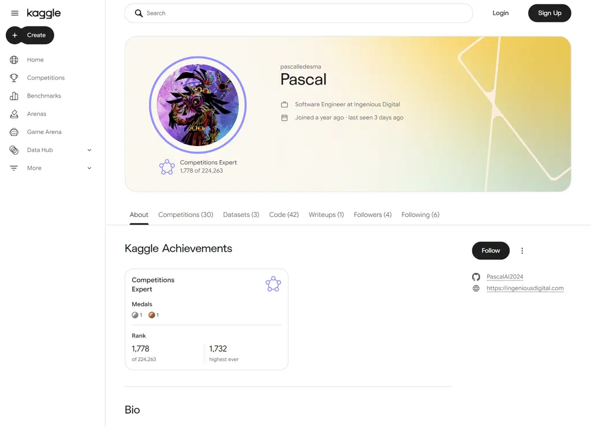

# Kaggle Fleet



A public record of my Kaggle work. Each competition that gets published here has a write-up, the solution code that runs, and the score with the date it was read off the public leaderboard. The profile the numbers come from is [kaggle.com/pascalledesma](https://www.kaggle.com/pascalledesma).

This repository is fresh. Nothing is published yet. The capture above was taken on 2026-11-05 and the rank in it moves; the profile page is the live source.

## Who this is for

Anyone who wants to check the work before talking to me. A hiring loop, a collaboration, or another competitor comparing a metric. A competition result is easy to claim and hard to verify, so the point of this repo is that each entry can be checked: run the code, read the write-up, open the leaderboard.

## Status

Fresh repository, started October 2026. Every entry below is still being cleaned up. Write-ups land as each competition is cleaned, one at a time, rather than all at once.

## Competitions entered (as of October 2026)

Entered, not yet published:

- ARC-AGI-3
- ARC-AGI-2
- IEEE Traffic Flow
- Enveda CASMI
- Name That LLM
- Smart Buildings
- Squares in Squares

Entering a competition is not a medal, a placement or a finished submission. Nothing in this list should be read as a result.

## How an entry gets added

One directory per competition, in this shape:

```
kaggle-fleet/
  squares-in-squares/
    README.md        problem, metric, validation split, what worked, what did not
    src/             the solution, runnable from a clean checkout
    results.md       public score and the date it was read
```

An entry only gets committed when all of these hold:

- the code runs from a clean checkout using only public data
- the write-up names the public score and where a reader can verify it
- no private data, credentials, teammate material or unreleased strategy is included
- the competition rules allow the code and the write-up to be public at that point

Anything that fails one of those checks stays out of the repository until it passes.

## What is not here

Private working notes, unreleased competition strategy, and any score or placement I cannot point at. If a number is not on a public leaderboard or in a dated capture, it does not appear.

## License

No licence yet. The solution code is published to be read; reuse terms will be set before the first entry lands.
